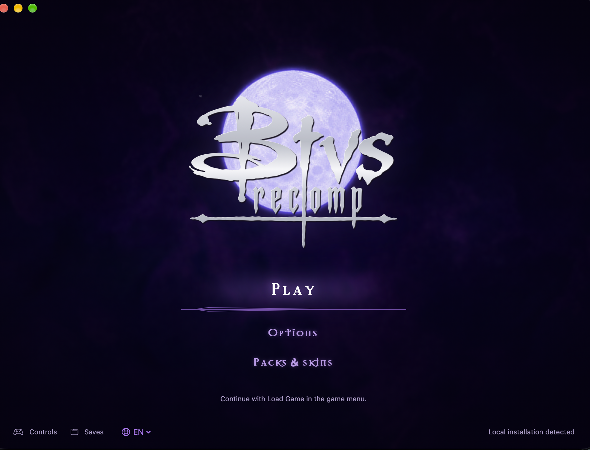
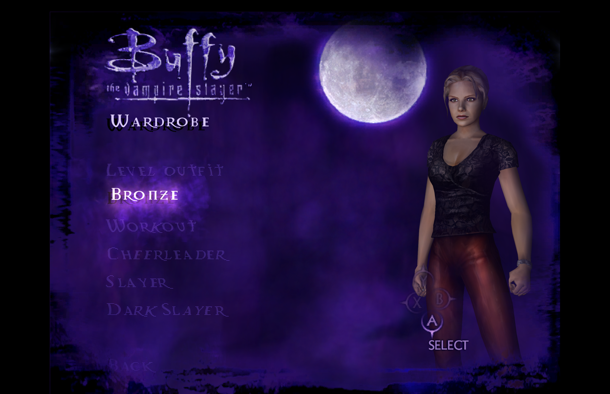
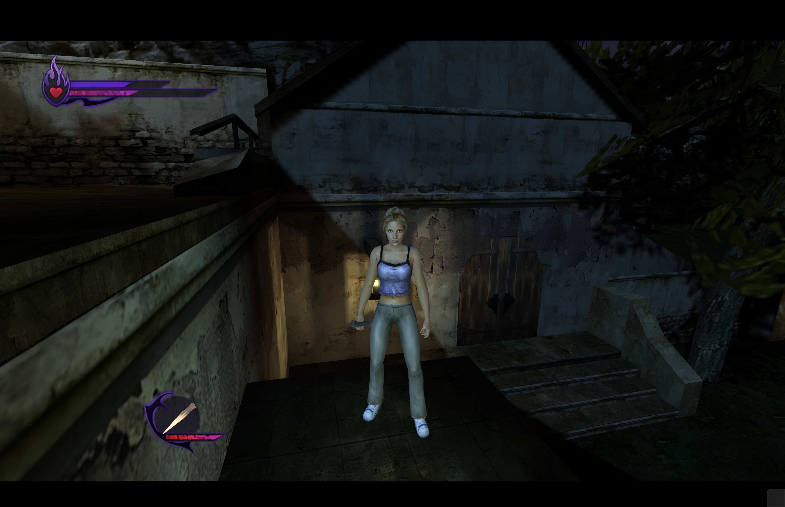
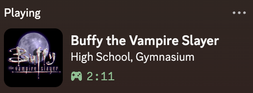
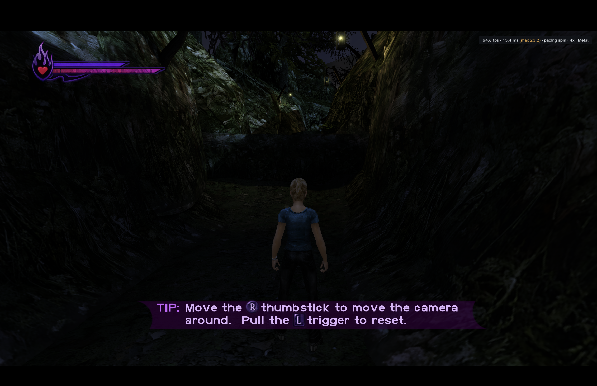
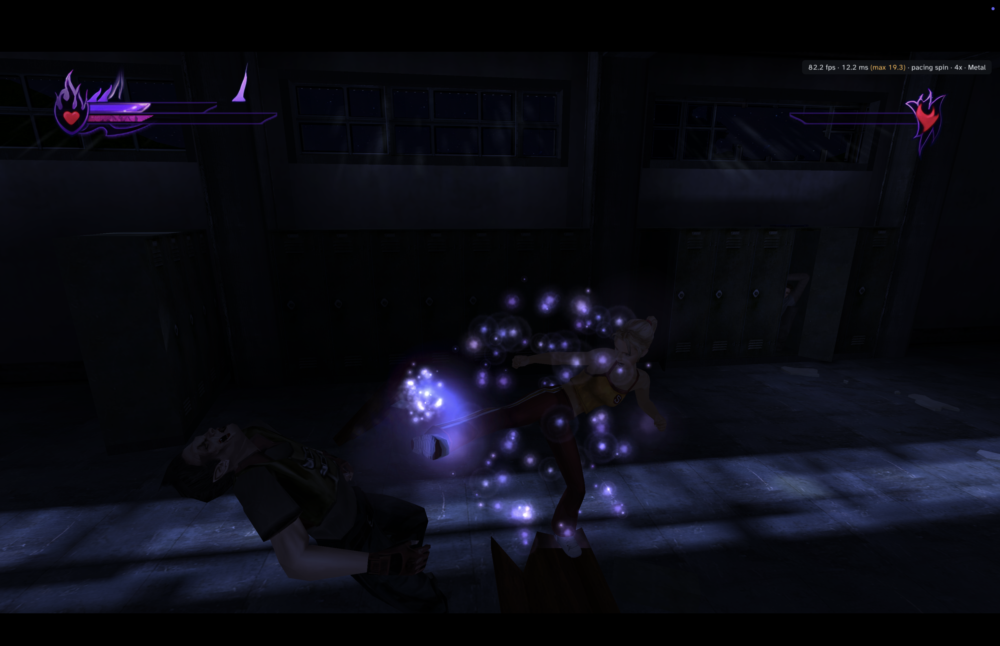
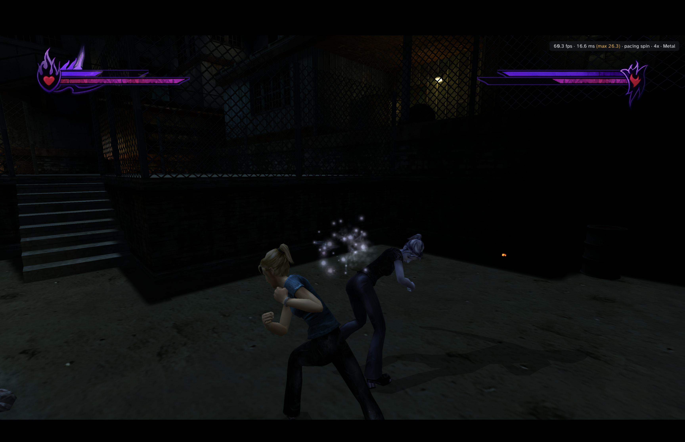

<div align="center">


**Buffy the Vampire Slayer · Original Xbox, 2002 · Apple Silicon**

An independent recompilation for macOS, with native ARM64 and Metal rendering.
Bring your own supported USA ISO. The game is built locally on your Mac.


<p>
<a href="https://github.com/wiluss/btvs-recomp/releases"></a>
<a href="docs/SETUP.md"></a>
<a href="docs/HD-PACK.md"></a>
<a href="https://github.com/wiluss/btvs-recomp/issues/new/choose"></a>
</p>

**`0.2.0-beta.1`** · Unofficial fan project · No game download

[What's new](#new-in-02) · [Screenshots](#a-glimpse-of-sunnydale) · [Get started](#start-playing) · [Updating](#already-playing) · [Known issues](#beta-status)

</div>

> [!IMPORTANT]
> **Made with substantial AI assistance**
>
> Codex and local Qwen helped with analysis, code proposals, debugging and documentation. AI tools also helped prepare branding and optional HD artwork, alongside manual refinements. Changes are reviewed and tested with gameplay feedback from the project owner; complete campaign compatibility remains unverified.
>
> **No AI model or service is required to install or play.**

## New in 0.2

- **A wardrobe for the Slayer.** Open **Outfits** from the original Main or Pause menu. Browse animated **3D previews** of Bronze, Workout, Cheerleader, Slayer and Dark Slayer, then wear your choice **immediately on Resume**. Back cancels browsing; **Level outfit** restores the normal appearance. Your choice is remembered. [Outfit guide →](docs/MODS.md#original-game-outfits)
- **Discord Rich Presence.** Share the current level, official game logo and session time under **Buffy the Vampire Slayer**. Enable it in Options with Discord running on the same Mac. It is off by default; no developer setup or token is needed. [Discord guide →](docs/DISCORD.md)
- **Your own texture mods.** Import compatible XRTP packs, enable or disable them, and set their priority in **Packs & skins**. Custom texture/skin overlays are separate from stock outfits; arbitrary 3D models and gameplay scripts are not supported. [Mod guide →](docs/MODS.md)
- **Automatic game-build updates.** The updater can now rebuild game changes locally, with progress and rollback. Existing alphas use a small compatibility update first. [Upgrade below →](#already-playing)

**Options → Outfit selector** is on by default. Turn it off before launching to skip the extra wardrobe preparation and model loading. Stock outfits come from your own ISO; no skin download is required. The native selector currently uses English labels.

> [!NOTE]
> **Outfit changes apply to gameplay.** Cutscenes keep the level's original outfit to preserve facial expressions and lip sync. Your chosen outfit returns automatically when gameplay resumes; your selection stays saved.

## Sunnydale, on your Mac

| Picture | Controls | Everyday comforts |
| :--- | :--- | :--- |
| ARM64 + Metal, resolution scaling, 4K output and experimental 16:9. | Keyboard and controller support, remapping, AZERTY/QWERTY presets. | Persistent saves, profile backups and a previewable problem report. |
| Optional HD textures, HUD and reconstructed text. | Optional arena access from the game's Extras menu. | Fullscreen, VSync, FPS overlay and a five-language launcher that follows your system language. |

## A glimpse of Sunnydale

<p align="center">

<br><sub>One place for your game, controls, saves and packs.</sub>
</p>

| Choose an outfit | Wear it in game |
| :---: | :---: |
|  |  |
| Animated 3D previews, accessible from Main or Pause. | Switch immediately on Resume; cutscenes retain their original outfits. |

<p align="center">

<br><sub>Optional Discord presence with the current level and session time.</sub>
</p>

| Explore Sunnydale | Fight back |
| :---: | :---: |
|  |  |
| A quiet moment on the trail. | A less quiet moment at school. |

<p align="center">

<br><sub>One more night in Sunnydale.</sub>
</p>

Unedited owner-supplied captures with optional HD content. FPS readings are individual scenes, not benchmarks. [Screenshot provenance →](docs/screenshots/README.md)

## Start playing

| You'll need | Details |
| :--- | :--- |
| **An Apple Silicon Mac** | macOS 13+ targeted; tested on one Mac running macOS 27.2. Native build tools and Homebrew packages are required. |
| **Your own supported USA ISO** | Buffy the Vampire Slayer, original Xbox, 2002. Setup checks the exact XBE and `final.map`; other editions or modified inputs are unsupported. |
| **Free space** | At least **35 GiB** before setup, plus space for the optional HD pack and wardrobe cache. |

1. **Download and verify** `btvs-recomp-v0.2.0-beta.1-source.zip` and `SHA256SUMS` from [Releases](https://github.com/wiluss/btvs-recomp/releases), then extract the folder.
2. **Build the launcher** using the [installation guide](docs/SETUP.md), or the commands below.
3. **Choose Set up from an ISO…** in the launcher. Select your image; setup verifies and imports the files, then compiles the game locally. It downloads build dependencies when needed, never the game.
4. **Play.** Start at the main menu. Choose **Load Game** to resume saved progress on later launches.

<details>
<summary><strong>Launcher build commands</strong></summary>

From a terminal in the extracted source folder:

```sh
# If Apple's Command Line Tools are not already installed:
xcode-select --install

# With Homebrew installed in /opt/homebrew:
HOMEBREW_NO_AUTO_UPDATE=1 brew install python@3.12 cmake ninja pkgconf sdl3 libepoxy openssl@3

python3 tools/bootstrap_runtime.py
make launcher
open "build/btvs-recomp.app"
```

Keep the source folder intact: the launcher runs from it. Moving only the `.app` to Applications is not supported.

</details>

### Add the HD treatment

Download **[btvs-recomp-HD-v1.zip](https://github.com/wiluss/btvs-recomp/releases/tag/v0.1.0-alpha.6)** (about 676 MB), then choose **Packs & skins → Install the HD pack…**. It includes prepared textures, HUD and reconstructed text with manual refinements. Textures and text can be switched off independently. [HD guide →](docs/HD-PACK.md)

**Already installed? Keep it.** The same HD v1 pack works with 0.2. It is a separate download; the source kit contains no playable game content.

## Already playing?

**Keep your existing import, saves, settings and HD pack. No ISO reimport or HD redownload is needed.**

| Your route | What to do |
| :--- | :--- |
| **Alpha.8/.9 update button** | Install **0.1.1 — Updater bridge**, quit and reopen the launcher, then check again to install **0.2.0-beta.1**. |
| **Direct upgrade from the beta ZIP** | Extract into a **separate folder**, close the old game/launcher, double-click **Update btvs-recomp.command**, and choose your **existing project folder**. No Terminal commands are needed. |

The bridge updates the updater; the beta adds the game features. Game builds run separately before installation, and failures retain or restore the previous version. Allow **30 GiB free** and several minutes when a rebuild is needed. Compatible launcher-only updates keep the fast path. [Update and recovery guide →](docs/SETUP.md#upgrade-to-02-from-an-alpha)

## Keep your progress

The launcher keeps the **three latest automatic copies of your whole save profile** before play. Open **Saves** for manual backups and restore while the game is closed. These protect saved progress; they are not in-game quicksaves.

Keep an external backup of **`private/profile/`**, including title metadata and disk files. Do not delete it when updating. [Saves and storage →](docs/GRAPHICS.md#saves-and-disk-storage)

## Beta status

**0.2 is a feature milestone, not a 1.0 compatibility claim.** The full campaign, long sessions and other Macs still need testing. Audio can stutter, an intermittent audio crash remains unresolved, and frame rate varies with effects and resolution. Stock controller mapping was tested physically; custom mappings and the new outfit menu need further physical testing.

[Known issues](docs/TROUBLESHOOTING.md) · [Validation summary](docs/BRINGUP.md) · [User guide](docs/GRAPHICS.md)

**Found a problem?** Use the launcher's ladybug button or **Help → Problem report**, then add your checkpoint and reproduction steps. [Reporting guide →](docs/TROUBLESHOOTING.md#reporting-a-problem). Never upload your ISO, game files, saves, disk images or entire project folder.

## Built independently

Based on the pinned generic [XboxRecomp macOS/Metal fork](https://github.com/apexJCL/xboxrecomp), with work by sp00nz and contributors. Prior research consulted BuffyNX; this project imports none of its title-specific code, symbols, seeds or overrides. Game-specific adaptations come from the identified user-supplied XBE and concordant MAP.

[Development](docs/DEVELOPMENT.md) · [Provenance](docs/PROVENANCE.md) · [Roadmap](docs/ROADMAP.md) · [Release notes](release/NOTES.md)

Original project code is [MIT licensed](LICENSE). Third-party components retain their licenses; game-derived HD content, branding and screenshot imagery are not relicensed under MIT. See the [notices](THIRD_PARTY_NOTICES.md). This project is not affiliated with the original rights holders.
